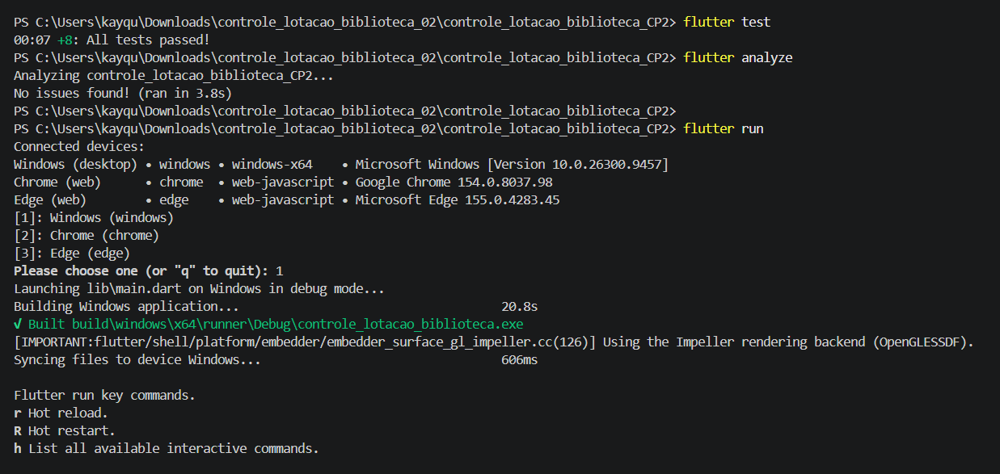

# Controle de Lotação 2.0 — Gerenciamento de Acessos

Aplicativo desenvolvido em Flutter para gerenciar a entrada e a saída de pessoas em uma biblioteca, acompanhar a ocupação do ambiente e impedir que a capacidade máxima seja ultrapassada.

## Demonstração

▶️ **Vídeo de demonstração:** [Assistir à demonstração no YouTube](https://youtu.be/Xb8G2HwTZEk?is=H30vfQItRoc8mkd9)


## Funcionalidades

- Exibição da quantidade de pessoas presentes e da capacidade máxima do ambiente.
- Indicador visual do nível de ocupação.
- Cadastro de pessoas com nome e matrícula/identificação.
- Registro de entrada e saída.
- Bloqueio de entradas quando o ambiente está lotado.
- Validação de campos obrigatórios e de matrículas duplicadas.
- Confirmação antes de registrar uma saída ou excluir um registro.
- Exclusão de registros.
- Mensagens de feedback usando `SnackBar`.
- Lista de registros com ações acessíveis por gesto de deslizar.
- Interface com componentes do Flutter, ícones e fontes do Google Fonts.

## Tecnologias e ferramentas

- Flutter
- Dart
- Material Design
- `google_fonts`
- Testes automatizados do Flutter

## Ambiente de desenvolvimento

- **Sistema operacional usado na validação:** Windows
- **Terminal:** PowerShell
- **Execução validada:** aplicativo desktop para Windows
- **Navegadores disponíveis no ambiente:** Google Chrome e Microsoft Edge

## Estrutura do projeto

```text
lib/
├── main.dart
├── models/
│   ├── ambiente.dart
│   └── pessoa.dart
├── pages/
│   └── controle_lotacao_page.dart
├── widgets/
│   └── pessoa_item.dart
└── docs/
    └── imagens/
        └── testes.png

test/
```

## Como executar

### 1. Pré-requisitos

Instale o [Flutter SDK](https://docs.flutter.dev/get-started/install) e configure o ambiente conforme a documentação oficial.

### 2. Instale as dependências

Na pasta raiz do projeto — a pasta que contém `pubspec.yaml` — execute:

```powershell
flutter pub get
```

### 3. Execute os testes automatizados

```powershell
flutter test
```

### 4. Analise o código

```powershell
flutter analyze
```

### 5. Execute o aplicativo no Windows

```powershell
flutter run -d windows
```

Também é possível executar no Chrome, se o dispositivo web estiver configurado:

```powershell
flutter run -d chrome
```

> A validação registrada neste README foi feita no Windows. Para compilar para Android, o Android SDK e o NDK precisam estar instalados e configurados corretamente.

## Evidências de validação

Os comandos abaixo foram executados no terminal do projeto.

| Comando | Resultado |
|---|---|
| `flutter test` | 8 testes aprovados (`+8: All tests passed!`) |
| `flutter analyze` | Nenhum problema encontrado (`No issues found!`) |
| `flutter run` | Aplicativo compilado e iniciado no Windows desktop |

### Captura de tela dos resultados

A imagem abaixo mostra a execução dos testes, a análise estática e a inicialização do aplicativo:



A compilação para Windows gerou o executável em:

```text
build/windows/x64/runner/Debug/controle_lotacao_biblioteca.exe
```

## Integrante

- Kayque Duarte Rodrigues

## Observações

Os registros fictícios de demonstração são carregados ao iniciar a tela para facilitar a visualização da ocupação e o teste das ações. Como os dados são mantidos em memória, eles são recriados quando o aplicativo é iniciado novamente; esta versão não utiliza persistência em banco de dados.
